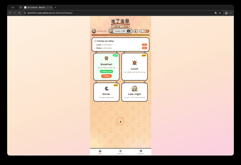
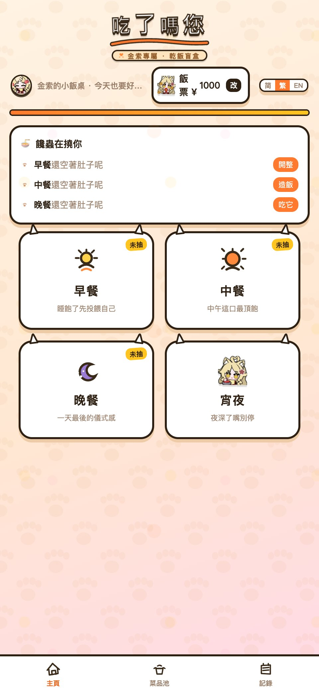
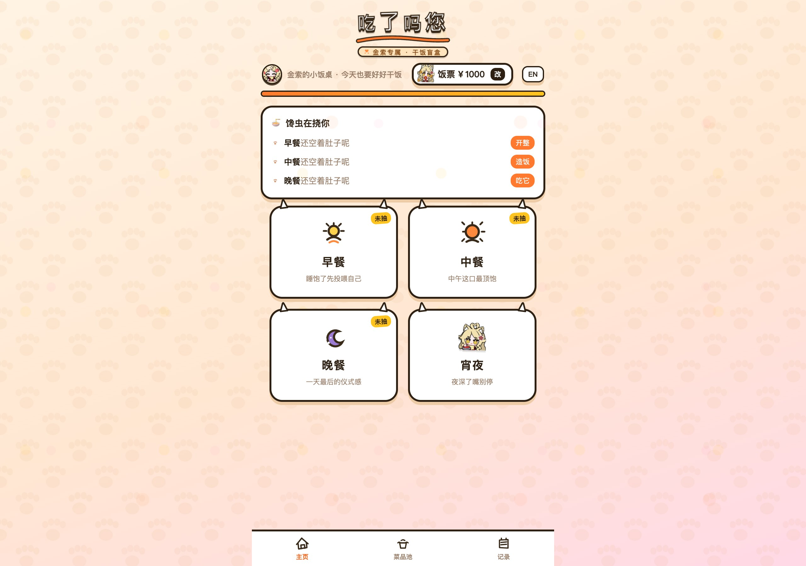

# Lucky Blind Box · 干饭盲盒

[](https://casp1an-hush.github.io/lucky-blind-box/) [](LICENSE) [](#run--运行) [](#run--运行) [](#run--运行) [](#run--运行) [](#features--功能亮点) [](https://github.com/Casp1an-hush/lucky-blind-box/releases/latest)

> Turn "what to eat" into a gacha ritual — Jin Suo's meal blind box.
> 把「今天吃什么」变成抽卡仪式 —— 金索的干饭盲盒。

**Live Demo / 在线演示：** <https://casp1an-hush.github.io/lucky-blind-box/> — Play instantly, no install needed. 点开即玩，无需安装。Best on mobile / 建议用手机打开。

Language switch / 语言切换：<https://casp1an-hush.github.io/lucky-blind-box/?lang=hant> (繁體) · <https://casp1an-hush.github.io/lucky-blind-box/?lang=en> (English).

> 📱 **Best viewed on a phone.** Designed for a portrait mobile screen. It also runs on desktop, but renders as a narrow centered column and will look odd.
> **建议用手机打开。** 本作品按竖屏手机设计。电脑上也能运行，但页面会显示为屏幕中间的一条窄栏，看起来会比较奇怪。

An interactive web app that turns "what should I eat" into a drawing ritual — making the most trivial daily decision something to look forward to.
一个把「今天吃什么」变成抽卡仪式的互动网页应用，把日常最琐碎的选择困难做成一件有期待感的小事。




## What it is · 这是什么

A light remedy for decision fatigue. Draw a dish for breakfast, lunch and dinner — with a system behind the draw.
选择困难症的轻量解药：给早餐、中餐、晚餐各抽一道菜，而抽卡本身有设计。

- **Ticket economy / 饭票经济** — A fixed daily ticket budget; dishes are charged only when you accept them, and you can overdraw. 每天有固定饭票预算，抽到的菜「收下」时才扣费，可以透支，形成轻度的资源管理。
- **Rarity tiers / 稀有度系统** — Common (70%), rare (25%), legendary (5%), each with its own reveal animation. 菜品分普通（70%）、稀有（25%）、限定（5%）三档，不同稀有度有完全不同的揭晓动画。
- **Custom pool / 自定义卡池** — Add your own dishes with your own rarity and price, and let fate pick them one day. 把自己的菜品加进池子，自己定稀有度和价格，让它有朝一日被命运抽中。
- **Streak check-in / 连续打卡** — Log what you eat by day, build a streak, unlock 3/7/14/30-day achievements. 按天记录吃了什么，累计连续干饭天数，解锁 3/7/14/30 天成就。
- **Meal cards / 三餐卡片** — Generate a shareable daily three-meal image card in one tap. 一键生成可保存分享的每日三餐图片卡片。
- **Three languages / 简 / 繁 / EN 三语** — One tap in the top bar switches the entire UI, dish names and card copy. 右上角一键切换，所有界面、菜品名与卡片文案都会同步。
- **Click feedback / 点击反馈** — Every tap gets a ripple, jelly bounce and sparkle burst; sounds are synthesized in-browser (no audio files), plus a light vibration on mobile. A speaker toggle mutes everything; the preference is saved locally. Visual effects turn off automatically under "reduce motion". 每次点击都有水波涟漪、果冻回弹与星光迸发；声音用浏览器原生合成（无需音频文件），手机还会轻震一下。顶栏小喇叭可一键静音，偏好本地保存；系统开启「减少动态效果」时视觉特效自动关闭。




## Draw animation · 抽卡动画

The core experience is a multi-stage ritual.
抽卡是核心体验，做成一个多阶段仪式。

1. **Charge / 蓄力** — The card back shakes rapidly as an energy ring converges. 卡背高速抖动，能量光环从中心汇聚。
2. **Reveal / 揭晓** — The card flips in 3D on the Y axis and bounces to rest. 卡片沿 Y 轴 3D 翻转入场，弹跳落定。
3. **Rarity variants / 稀有度差异化**:
   - Common / 普通 — light particles. 轻量粒子。
   - Rare / 稀有 — breathing gold glow, expanding ring, star particles, a "Rare" banner. 金色辉光呼吸、光环扩散、星星粒子、「稀有」横幅。
   - Legendary / 限定 — purple energy burst, full-screen flash, dense particles, sustained glow, blessing barrage. 紫色能量爆发、全屏闪光、大量粒子、持续辉光、弹幕祝福。
4. **Landing / 落地** — The card art gently floats, waiting for you to "eat it" or "skip". 卡面插画轻微浮动，等待你「吃吃吃」或「不要」。

All built with CSS `@keyframes` and a little vanilla JS, respecting `prefers-reduced-motion`.
全部用 CSS `@keyframes` 加少量原生 JS 实现，遵循 `prefers-reduced-motion`（系统开启减少动效时自动关闭）。

## Tech · 技术实现

A single-page app with zero third-party dependencies and zero build steps.
单页应用，零第三方依赖、零构建步骤。

- **One HTML file / 一个 HTML 文件** holds all structure, styles and logic (~168KB). 承载全部结构、样式、逻辑（约 168KB）。
- **Illustrations generated in code / 插画由代码生成** — Card art is drawn as SVG at runtime (colors and shapes hashed from the dish name), so any new dish gets its own art. 卡面菜品插画运行时用 SVG 绘制（按菜名哈希生成配色与图形），所以任何新加的菜都有专属卡面。
- **All data local / 数据全部本地** — Pool, meal log, tickets and check-ins live in browser `localStorage`; nothing is uploaded, and it works offline. 菜品池、吃饭记录、饭票、打卡都存在浏览器 `localStorage`，不上传服务器，离线也能用。
- **Hand-drawn look / 手绘风视觉** — Warm orange palette, rounded thick outlines, paper-like texture; the mascot floats gently. 暖橙配色、圆角粗描边、拟物纸质质感，吉祥物插画随界面轻微浮动。
- **Dynamic background / 动态背景** — Flowing warm gradients, breathing glows, drifting paw prints, twinkling stardust, occasional meteors, expanding ripples, 18 rising bubbles and 6 paw prints — all beneath the content layer. Everything turns off under "reduce motion". 流动的暖色渐变、呼吸式彩色光晕、漂移猫爪纹理、闪烁星尘、不定时划过的流星、扩散水波、18 颗上浮气泡与 6 枚爪印，全部位于内容层之下，系统开启「减少动态效果」时自动关闭。
- **Responsive / 响应式** — Works from phone to widescreen. 从手机到宽屏都适配。
- **Ready to publish / 可直接发布** — Served on GitHub Pages with Open Graph / Twitter Card meta, so shares show a title, description and preview image; on mobile, "Add to Home Screen" opens it full-screen as a web app. 挂在 GitHub Pages 上，主页 `<meta>` 含 Open Graph / Twitter Card 元信息，分享时显示标题、描述与预览图；手机上「添加到主屏幕」后以全屏 Web App 打开。

Widescreen preview / 宽屏预览：



## Run · 运行

No dependencies, no API key, no network needed. Only **Python 3** is required to start a local static server so `localStorage` and image export behave consistently in every browser.
无需安装依赖、无需 API key、无需联网。只需 **Python 3** 起一个本地静态服务，让 localStorage 和图片导出在所有浏览器下都正常。

> Designed for a portrait phone screen. Desktop works, but shows a narrow centered column.
> 界面按手机竖屏设计，电脑上可运行，但布局是屏幕中央的一条窄栏。

### macOS

Double-click `Lucky Blind Box.app` (recommended, with icon) or `run.command`. The browser opens `http://127.0.0.1:8765/` automatically.
双击 `Lucky Blind Box.app`（推荐，带图标）或 `run.command`，浏览器会自动打开 `http://127.0.0.1:8765/`。

> A `.app` downloaded from GitHub may trigger "unknown developer": right-click → Open → Open again. This is normal for unsigned apps.
> 从 GitHub 下载的 `.app` 可能触发「来自未知开发者」提示：右键 → 打开 → 再点「打开」即可，这是未签名应用的正常现象。

### Windows

Double-click `run.cmd`; the browser opens automatically.
双击 `run.cmd`，浏览器会自动打开。

### Manual / 手动运行

```bash
python3 serve.py 8765
```

Then open <http://127.0.0.1:8765/>. Press `Ctrl+C` in the terminal to stop.
然后打开 <http://127.0.0.1:8765/>，关闭时在运行窗口按 `Ctrl+C`。

### Why not open file:// directly / 为什么不用 file:// 直接打开

Some browsers restrict `localStorage` and Canvas export under `file://`; a local HTTP server keeps everything working. Data still stays only in your own browser.
部分浏览器对 `file://` 下的 `localStorage` 和 Canvas 图片导出有限制，用本地 HTTP 服务能保证所有功能正常。数据仍然只留在你自己的浏览器里。

## Structure · 项目结构

```
index.html              All app code (structure / styles / logic / SVG art) · 全部应用代码
.nojekyll               Static passthrough for GitHub Pages · 让 Pages 原样直出静态文件
serve.py                Zero-dependency static server (stdlib only) · 零依赖本地静态服务器
run.command             macOS launcher · macOS 启动脚本
run.cmd                 Windows launcher · Windows 启动脚本
Lucky Blind Box.app/    macOS app bundle (double-click, with icon) · macOS 应用包
  Contents/Resources/AppIcon.icns
LuckyBlindBox.ico       Windows icon · Windows 图标
AppIcon.icns            macOS icon source · macOS 图标源文件
assets/                 Mascot illustrations (8 webp) · 吉祥物插画
docs/screenshots/       Preview images · 预览图
```

## Design notes · 设计说明

This piece is about "packaging data logic as an emotional experience": the same random meal picker, reorganized with rarity, animation and a ticket economy, becomes a small thing you want to reopen. The tech is deliberately simple (single file, zero dependencies, fully local) — the complexity lives in interaction design, not engineering.
这个作品关注「把数据逻辑包装成情绪体验」：同样的随机选餐，用抽卡的稀有度、动画和饭票机制重新组织后，就从工具变成愿意反复打开的小东西。技术上刻意保持简单（单文件、零依赖、纯本地），把复杂度放在交互设计而非工程架构上。

Built with human–AI collaboration: requirements, experience design and acceptance were led by the author; AI tooling assisted implementation.
开发与实现采用人机协作方式完成：以需求定义、体验设计和结果验收为主导，实现环节借助 AI 工具链完成。

## Changelog · 更新日志

See [CHANGELOG.md](CHANGELOG.md).
见 [CHANGELOG.md](CHANGELOG.md)。

## License · 许可

MIT — see [LICENSE](LICENSE).
MIT — 见 [LICENSE](LICENSE)。
