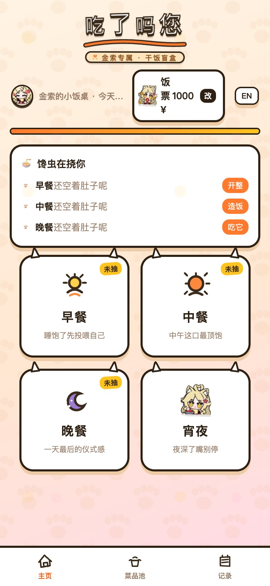

# Lucky Blind Box · 干饭盲盒

> 吃了吗您 · 金索的干饭盲盒

一个把「今天吃什么」变成抽卡仪式的互动网页应用。把日常最琐碎的选择困难，做成一件有期待感的小事。



## 这是什么

选择困难症的轻量解药。给早餐、中餐、晚餐各抽一道菜——但抽卡本身有设计：

- **饭票经济**：每天有固定饭票预算，抽到的菜「收下」时才扣费，可以透支，形成轻度的资源管理。
- **稀有度系统**：菜品分普通（70%）、稀有（25%）、限定（5%）三档，不同稀有度有完全不同的揭晓动画。
- **自定义卡池**：可以把自己的菜品加进池子，自己定稀有度和价格，让它有朝一日被命运抽中。
- **连续打卡**：按天记录吃了什么，累计连续干饭天数，解锁 3/7/14/30 天成就。
- **三餐卡片**：一键生成可保存分享的每日三餐图片卡片。
- **简 / 繁 / EN 三语**：右上角一键切换，所有界面、菜品名与卡片文案都会同步。


## 抽卡动画

抽卡是这个作品的核心体验，做成了一个多阶段仪式：

1. **蓄力**：卡背高速抖动，能量光环从中心汇聚。
2. **揭晓**：卡片沿 Y 轴 3D 翻转入场，弹跳落定。
3. **稀有度差异化**：
   - 普通 —— 轻量粒子；
   - 稀有 —— 金色辉光呼吸 + 光环扩散 + 星星粒子 + 「稀有」横幅；
   - 限定 —— 紫色能量爆发 + 全屏闪光 + 大量粒子 + 持续辉光 + 弹幕祝福。
4. **落地**：卡面插画轻微浮动，等待你「吃吃吃」或「不要」。

全部用 CSS `@keyframes` + 少量原生 JS 粒子实现，并遵循 `prefers-reduced-motion`（系统开启减少动效时自动关闭）。

## 技术实现

单页应用，零第三方依赖、零构建步骤：

- **一个 HTML 文件**承载全部结构、样式、逻辑（约 130KB）。
- **插画由代码生成**：卡面菜品插画是运行时用 SVG 绘制的（按菜名哈希生成配色与图形），不是图片素材，所以任何新加的菜都有专属卡面。
- **数据全部本地**：菜品池、吃饭记录、饭票、打卡都存在浏览器的 `localStorage`，不上传任何服务器，离线也能用。
- **手绘风视觉**：暖橙配色、圆角粗描边、拟物纸质质感；吉祥物插画随界面轻微浮动。
- **响应式**：从手机到宽屏都适配。

宽屏预览：


## 运行

无需安装依赖，无需 API key，无需联网。需要一个 **Python 3**（仅用来起一个本地静态服务，让 localStorage 和图片导出在所有浏览器下都正常）。

### macOS

双击 `Lucky Blind Box.app`（推荐，带图标）或双击 `run.command`。浏览器会自动打开 `http://127.0.0.1:8765/`。

> 从 GitHub 下载的 `.app` 可能触发「来自未知开发者」提示：右键 → 打开 → 再点「打开」即可。这是未签名应用的正常现象。

### Windows

双击 `run.cmd`，浏览器会自动打开。

### 手动运行

```bash
python3 serve.py 8765
```

然后打开 <http://127.0.0.1:8765/>。关闭时在运行窗口按 `Ctrl+C`。

### 为什么不用 file:// 直接打开

部分浏览器对 `file://` 协议下的 `localStorage` 和 Canvas 图片导出有限制，用本地 HTTP 服务能保证所有功能正常。数据仍然只留在你自己的浏览器里。

## 项目结构

```
index.html              全部应用代码（结构 / 样式 / 逻辑 / SVG 插画生成）
serve.py                零依赖本地静态服务器（只用 Python 标准库）
run.command             macOS 启动脚本
run.cmd                 Windows 启动脚本
Lucky Blind Box.app/     macOS 应用包（双击即用，带图标）
  Contents/Resources/AppIcon.icns
LuckyBlindBox.ico       Windows 图标
AppIcon.icns            macOS 图标源文件
assets/                 吉祥物插画（8 张 webp）
docs/screenshots/       预览图
```

## 设计说明

这个作品关注的是「把数据逻辑包装成情绪体验」：同样的随机选餐，用抽卡的稀有度、动画和饭票机制重新组织后，就从一个工具变成了一件愿意反复打开的小东西。技术上刻意保持简单（单文件、零依赖、纯本地），把复杂度放在交互设计而非工程架构上。

开发与实现采用人机协作方式完成：以需求定义、体验设计和结果验收为主导，实现环节借助 AI 工具链完成。

## 许可

MIT
